# Cloud Invoice Manager

A serverless invoice management application built on AWS using Python, AWS Lambda, API Gateway, DynamoDB, and Amazon S3. The project demonstrates practical cloud development, infrastructure automation with Terraform, serverless application deployment, file storage, security configuration, and monitoring.

- **Project status:** Deployed and tested
- **Cloud provider:** Amazon Web Services (AWS)
**Region:** `us-east-1`

## Live Demo

[Open Cloud Invoice Manager](http://cloud-invoice-manager-dev-website-881490105230.s3-website-us-east-1.amazonaws.com)

> The demo is hosted using the Amazon S3 static website endpoint, which uses HTTP. It is intended for demonstration purposes and does not include user authentication. Use fictional invoice information only.

## Project Overview

Cloud Invoice Manager provides a simple web interface for managing invoice records and their supporting documents.

The application allows users to create, view, search, filter, edit, and delete invoices. Invoice documents are uploaded to a private Amazon S3 bucket, while invoice metadata is stored in Amazon DynamoDB.

The backend is implemented with AWS Lambda and exposed through Amazon API Gateway. The infrastructure is provisioned using Terraform.

The project was developed to demonstrate how AWS services can work together to deliver a practical, serverless application.

## Architecture

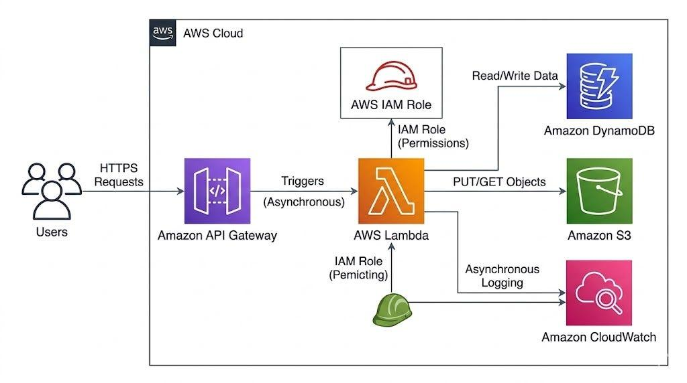

### How It Works

1. A user interacts with the web application hosted in an Amazon S3 static website bucket.
2. The frontend sends HTTP requests to Amazon API Gateway.
3. API Gateway invokes the AWS Lambda function.
4. Lambda processes the request and interacts with Amazon DynamoDB to manage invoice metadata.
5. Invoice documents are stored in a separate private Amazon S3 bucket.
6. Lambda generates pre-signed S3 URLs for secure document uploads and downloads.
7. Amazon CloudWatch collects Lambda logs for monitoring and troubleshooting.

### AWS Services Used

| AWS Service | Purpose |
|---|---|
| Amazon S3 | Hosts the frontend website and stores invoice documents in a separate private bucket |
| AWS Lambda | Runs the Python serverless backend |
| Amazon API Gateway | Exposes HTTP endpoints for frontend-to-backend communication |
| Amazon DynamoDB | Stores invoice metadata |
| AWS IAM | Controls permissions for Lambda access to AWS resources |
| Amazon CloudWatch | Collects application logs |
| Terraform | Provisions and manages the AWS infrastructure |

## Application Features

- **Dashboard:** Displays invoice information and summary metrics.
- **Create invoices:** Adds invoice details and uploads supporting documents.
- **View invoices:** Retrieves and displays saved invoice records.
- **Search and filter:** Helps users find invoices using available fields and status filters.
- **Edit invoices:** Updates existing invoice information.
- **Delete invoices:** Removes invoice metadata and its associated document from S3.
- **Document upload:** Uses pre-signed URLs to upload invoice documents to S3.
- **Document download:** Generates pre-signed URLs to retrieve stored invoice documents.

## Technology Stack

**Frontend**
- HTML
- CSS
- JavaScript

**Backend**
- Python 3.12
- AWS Lambda
- Boto3

**Cloud Infrastructure**
- Amazon API Gateway HTTP API
- Amazon DynamoDB
- Amazon S3
- AWS IAM
- Amazon CloudWatch

**Infrastructure as Code**
- Terraform

**Testing and Development**
- Python unittest
- Node.js syntax checking
- AWS CLI
- Visual Studio Code
- Git and GitHub

## Project Structure

```text
cloud-invoice-manager/
│
├── architecture/
│   └── cloud-invoice-architecture.png
│
├── backend/
│   └── lambda/
│       └── handler.py
│
├── frontend/
│   ├── index.html
│   ├── styles.css
│   └── app.js
│
├── infrastructure/
│   ├── main.tf
│   ├── variables.tf
│   ├── outputs.tf
│   └── ...
│
├── tests/
│   └── test_handler.py
│
├── docs/
│   ├── screenshots/
│   ├── architecture-decisions.md
│   ├── implementation-guide.md
│   ├── security-and-iam.md
│   └── testing-and-troubleshooting.md
│
├── .gitignore
└── README.md
```

*The structure above highlights the main project files. Additional Terraform configuration and supporting files may also be present.*

## API Endpoints

The backend exposes the following HTTP routes:

| Method | Endpoint | Description |
|---|---|---|
| GET | `/invoices` | Retrieve invoices |
| GET | `/invoices/{id}` | Retrieve a specific invoice |
| POST | `/invoices/upload-url` | Generate a pre-signed upload URL |
| POST | `/invoices` | Create an invoice |
| PUT | `/invoices/{id}` | Update an invoice |
| GET | `/invoices/{id}/download-url` | Generate a document download URL |
| DELETE | `/invoices/{id}` | Delete an invoice and its document |

## Infrastructure Deployment

The AWS infrastructure is managed using Terraform.

### Prerequisites

Before deploying, install and configure:

- AWS CLI
- Terraform
- Python 3.12
- Git

You also need an AWS account and an IAM identity with permissions to create and manage the resources defined in the Terraform configuration.

### 1. Clone the repository

```bash
git clone https://github.com/aj-sys/cloud-invoice-manager.git
cd cloud-invoice-manager
```

### 2. Configure AWS credentials

Configure your AWS CLI credentials using your own IAM identity:

```bash
aws configure
```

Do not commit AWS access keys, secret keys, session tokens, or other credentials to GitHub.

### 3. Initialise Terraform

```bash
cd infrastructure
terraform init
```

### 4. Validate the configuration

```bash
terraform validate
```

### 5. Review the deployment plan

```bash
terraform plan
```

Review the proposed changes carefully before deployment.

### 6. Deploy the infrastructure

```bash
terraform apply
```

Confirm the deployment only after reviewing the plan and understanding the resources and potential AWS charges.

### 7. View the deployment outputs

```bash
terraform output
```

The outputs include the API endpoint, website endpoint, Lambda function name, DynamoDB table name, and S3 bucket names.

> **Important:** AWS services may incur charges. Review current AWS pricing and monitor your account usage. When the demonstration is complete, review the Terraform destroy plan and remove resources you no longer need.

## Testing and Validation

The application was tested locally and against the deployed AWS environment.

### Automated Tests

The backend test suite contains 23 tests.

Run the tests from the project root:

```bash
python -m unittest discover -s tests -v
```

### Syntax Validation

Python backend syntax:

```bash
python -m py_compile backend/lambda/handler.py
```

JavaScript frontend syntax:

```bash
node --check frontend/app.js
```

### Live AWS Testing

The deployed application was tested for:

- Website availability.
- API communication.
- Invoice creation and retrieval.
- Invoice editing.
- Invoice deletion.
- PDF document upload.
- PDF document download.
- DynamoDB metadata storage.
- S3 document storage.
- Removal of the associated S3 document after invoice deletion.
- Lambda execution and CloudWatch logging.

The application successfully completed the tested invoice-management workflows.

## Security Considerations

Security controls were implemented with the project's demonstration scope in mind.

### IAM permissions

The Lambda execution role uses resource-scoped permissions for the DynamoDB table, invoice document objects in S3, and the Lambda CloudWatch log group.

The application does not require administrator-level permissions for its normal execution.

### Private invoice document storage

Invoice documents are stored in a separate private S3 bucket.

The bucket has:

- S3 Block Public Access enabled.
- Server-side encryption using AES-256.
- A bucket policy requiring secure transport (HTTPS/TLS).

### Pre-signed URLs

Pre-signed URLs are used to allow temporary access to invoice documents without making the document bucket public.

### CloudWatch logging

Lambda execution logs are sent to CloudWatch Logs. The configured log retention period is 14 days.

### Known security limitations

This is a portfolio demonstration, not a production-ready financial application.

- The API currently has no user authentication or authorisation.
- The API Gateway routes use `AuthorizationType NONE`.
- The public website is hosted on an S3 website endpoint using HTTP.
- The application is intended for fictional demonstration data only.
- Production deployment would require authentication, appropriate user-level access controls, HTTPS delivery, stronger operational safeguards, and additional security testing.

CORS configuration is not a substitute for API authentication.

## Screenshots and Evidence

The following screenshots document the application's development, deployment, and testing.

### Local Application Development

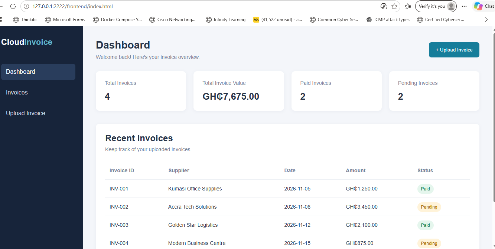

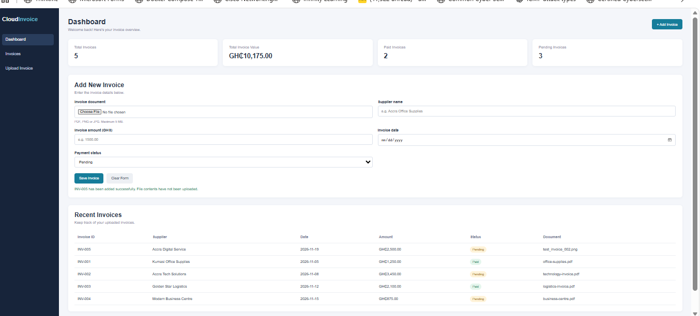

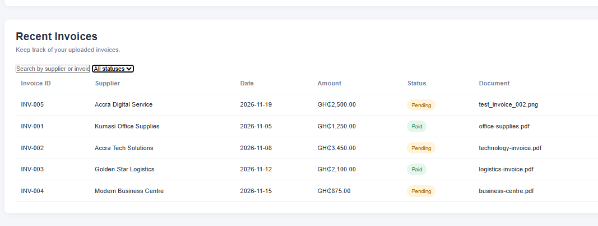

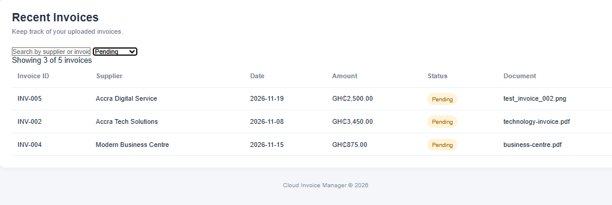

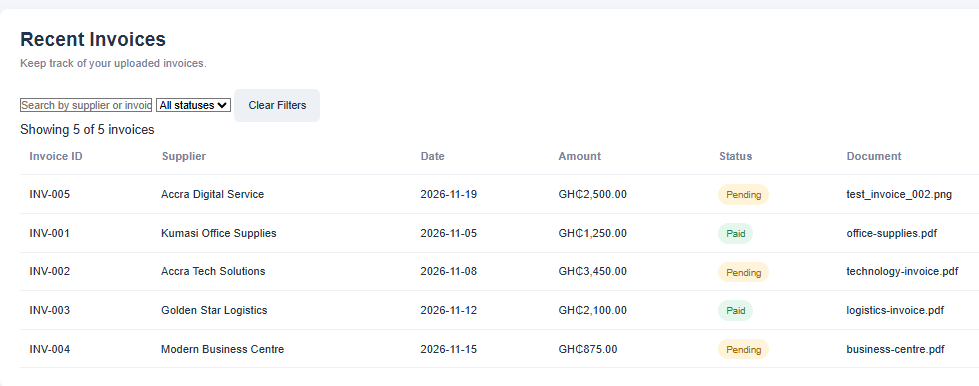

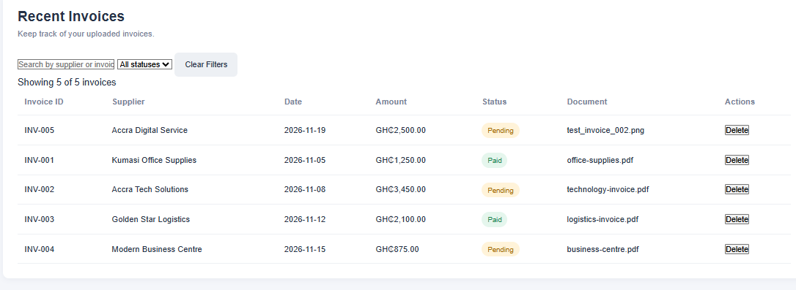

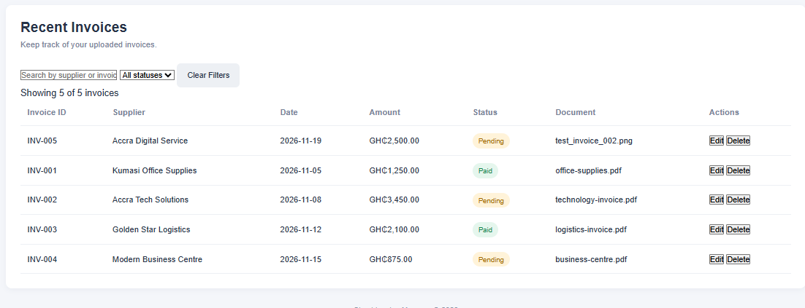

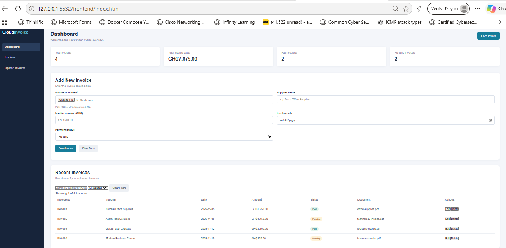

### AWS Infrastructure Deployment

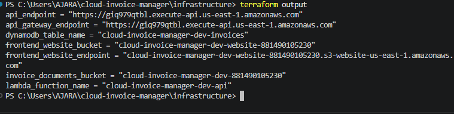

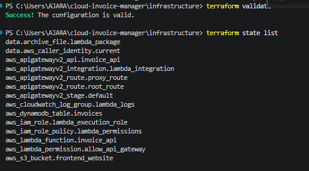

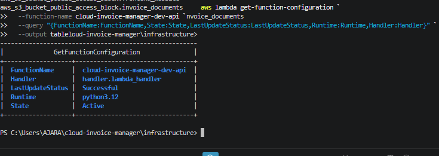

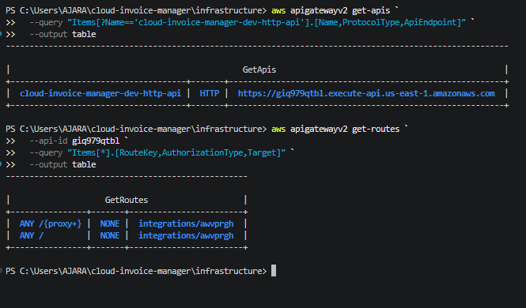

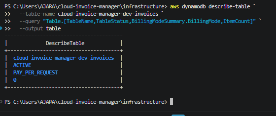

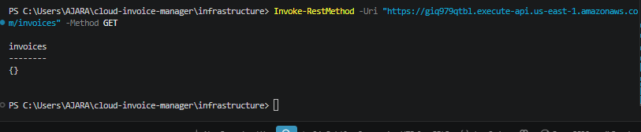

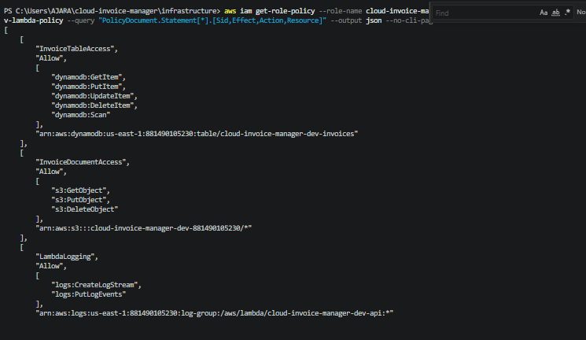

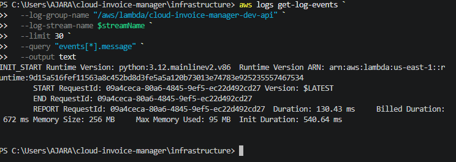

### Hosted Application Testing

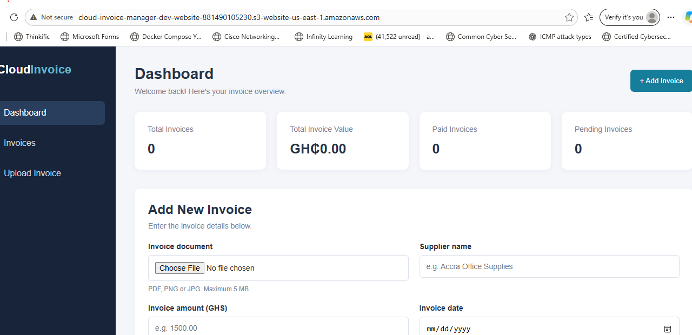

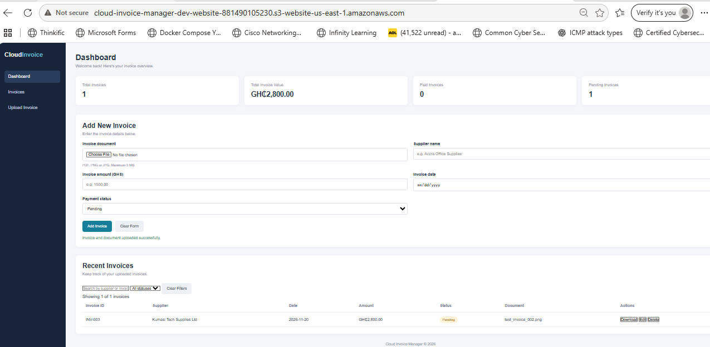

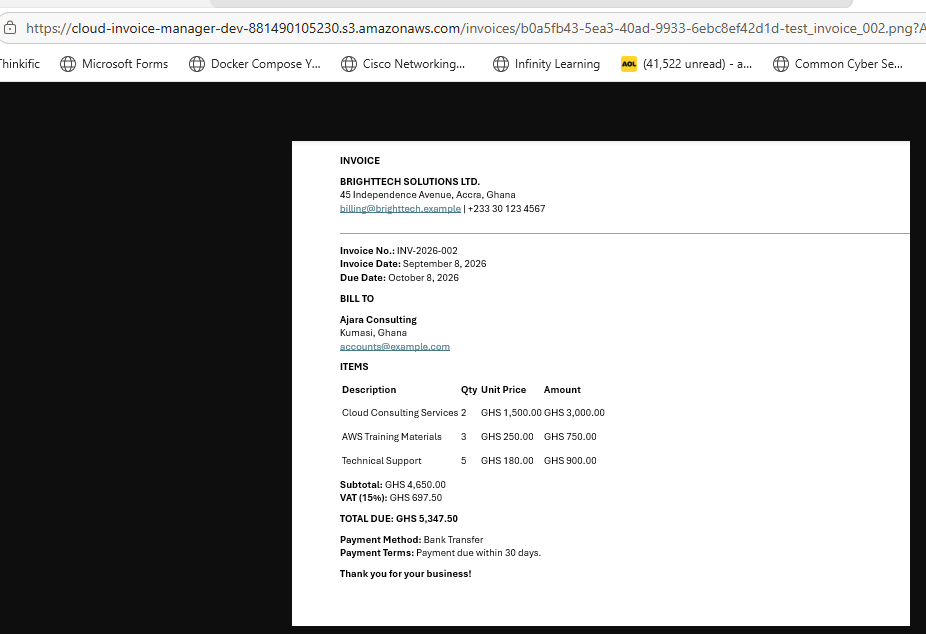

## Documentation

Additional project documentation is available in the `docs/` directory:

- **[Architecture Decisions](docs/architecture-decisions.md):** Important design and implementation decisions.
- **[Implementation Guide](docs/implementation-guide.md):** Project implementation details.
- **[Security and IAM](docs/security-and-iam.md):** IAM permissions and security configuration.
- **[Testing and Troubleshooting](docs/testing-and-troubleshooting.md):** Test procedures and troubleshooting notes.

## Key Learning Outcomes

This project provided practical experience with:

- Designing and deploying a serverless AWS application.
- Connecting a frontend to an API Gateway HTTP API.
- Building Python-based AWS Lambda functions.
- Working with DynamoDB for application data persistence.
- Managing private document storage using Amazon S3.
- Using pre-signed URLs for temporary document access.
- Configuring IAM roles and resource-level permissions.
- Provisioning AWS resources using Terraform.
- Reviewing deployment plans and managing infrastructure changes.
- Troubleshooting AWS service integrations.
- Monitoring Lambda execution through CloudWatch Logs.
- Testing CRUD operations and document lifecycle management.
- Documenting architecture, deployment, security, and testing evidence.

## Future Improvements

Potential improvements for a production-oriented version include:

- User authentication and role-based access control.
- HTTPS delivery through Amazon CloudFront.
- Improved input validation and API error handling.
- Pagination and more efficient DynamoDB access patterns.
- Automated deployment through GitHub Actions.
- Infrastructure and application security scanning.
- Enhanced monitoring, alarms, and operational dashboards.
- Audit logging and backup/recovery procedures.

## Author

**Ajara Amadu**

Associate Cloud Trainer | AWS Certified | Cloud and DevOps Practitioner

- GitHub: [github.com/aj-sys](https://github.com/aj-sys)
- LinkedIn: [Ajara Amadu](https://www.linkedin.com/in/ajara-amadu-profile/)

---

*Built as a practical AWS serverless and Infrastructure-as-Code portfolio project.*
